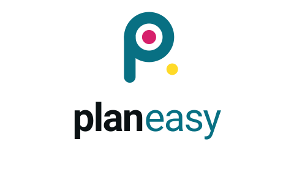

<table border="0" cellpadding="0" cellspacing="0" style="border:1px solid transparent;">
  <tr style="border:1px solid transparent;">
    <td style="border:1px solid transparent; vertical-align: middle; padding-right: 16px;">
      
    </td>
    <td style="border:1px solid transparent; vertical-align: middle;">
      <h1 style="margin: 0; padding: 0;">PlanEasy Ecosystem</h1>
      
<strong>Integrated Framework for Spatial Analysis, Crowdsourcing, and Participatory Research</strong>

    </td>
  </tr>
</table>

---

## 🌍 Overview

**PlanEasy** is an open research and development ecosystem that integrates **WebGIS visualization**,  
**crowdsourced data collection**, and **participatory research** into a single interoperable framework.

It provides modular tools and data standards for projects in:
- 🚍 Mobility and transport planning  
- 🧭 Accessibility and spatial analysis  
- 🚲 Road safety and behaviour research  
- 🧠 Citizen science and survey-based studies  

All components follow **FAIR data principles** (Findable, Accessible, Interoperable, Reusable)  
and comply with **GDPR (Art. 89)** standards for scientific research.

> The PlanEasy ecosystem supports **transparent, ethical, and reproducible** workflows  
> across academic, institutional, and civic research projects.

---

## 🧩 The PlanEasy Ecosystem

| Module | Description | Repository |
|---------|--------------|-------------|
| 🗺️ **PlanEasy WebGIS Framework** | Cloud-based environment for spatial visualization, accessibility analysis, and mobility dashboards. | [🔗 planeasy-webgis-framework](https://github.com/planeasy-webgis/planeasy-webgis-framework) |
| 👥 **PlanEasy Crowdsourcing Framework** | Ethical and GDPR-compliant system for participatory data collection and citizen science. Includes the official library of multilingual **questionnaire templates** for behavioural and perception research. | [🔗 planeasy-crowdsourcing-framework](https://github.com/planeasy-webgis/planeasy-crowdsourcing-framework) |

All modules share a unified data model and can be integrated seamlessly through APIs or direct JSON schemas.

---

## ⚙️ Key Features

- Cloud-native WebGIS dashboard for mobility and land-use analysis  
- Modular data collection workflows for surveys and crowdsourced contributions  
- Privacy-by-design architecture compliant with GDPR  
- FAIR-aligned data formats for long-term research reproducibility  
- Integration-ready APIs and visual analytics  

---

## 🧪 Example Applications

| Application | Description |
|--------------|--------------|
| **Public Transport Demand for Large Events** | Estimation of transport demand using tourist accommodations, attractions, and GTFS data. |
| **[Road Safety Analysis](https://road-safety.wemolab.eu/)** | Interactive map and dashboard for accident and risk data visualization. |
| **[Accessibility Studies](https://reachability.wemolab.eu/)** | Evaluation of travel-time accessibility for schools, workplaces, and essential services. |
| **[Mobility Surveys](https://questionnaire-builder.wemolab.eu/)** | Web-based multilingual surveys on perception, safety, and mode choice. |

---

## 👩‍🔬 Authors

- **Prof. Guido Gentile**  
- **Dr. Lory Michelle Bresciani Miristice**

---

## 📄 License

All repositories in this organization are released under the  
**Creative Commons Attribution–NonCommercial 4.0 International (CC BY-NC 4.0)** license.

📄 [Full license text](https://creativecommons.org/licenses/by-nc/4.0/)

---

## 📬 Contact

📧 **Dr. Lory Michelle Bresciani Miristice**  
[lorymichellebrescianimiristice@uniroma1.it](mailto:lorymichellebrescianimiristice@uniroma1.it)

---

> ℹ️ The PlanEasy organization hosts interoperable frameworks and documentation  
> supporting participatory, spatial, and transport-related research projects.
